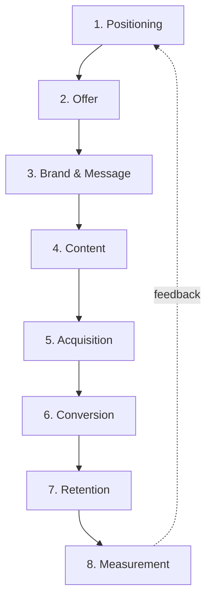

# Marketing — Operating Map

Marketing is not a channel. It is eight systems that decide, in order, what you
sell, to whom, why you are chosen, how people find you, how they convert, and
whether any of it worked.

| # | Area | The question it answers | File |
| --- | --- | --- | --- |
| 1 | Positioning | Who exactly, and against what alternative? | [01-positioning.md](01-positioning.md) |
| 2 | Offer | What exactly do they buy, at what price, with what promise? | [02-offer.md](02-offer.md) |
| 3 | Brand & Message | Why should they believe you and not the other one? | [03-brand-message.md](03-brand-message.md) |
| 4 | Content | What do we publish, and who makes it? | [04-content.md](04-content.md) |
| 5 | Acquisition | How do strangers arrive? | [05-acquisition.md](05-acquisition.md) |
| 6 | Conversion | Where do they stop, and why? | [06-conversion.md](06-conversion.md) |
| 7 | Retention | Why do they stay, buy again, refer? | [07-retention.md](07-retention.md) |
| 8 | Measurement | What is true, and what are we guessing? | [08-measurement.md](08-measurement.md) |

## The rule of order

You cannot fix acquisition on top of a broken offer. Every euro spent on traffic
is multiplied by the quality of the layers above it — so work top to bottom.
If the answer to "who exactly" is vague, stop: everything below is decoration.
